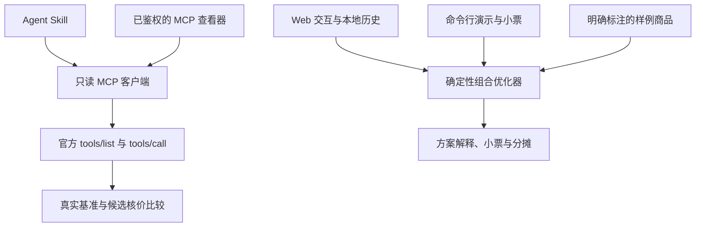

# 架构与算法边界

## 设计目标

麦麦刚刚好先确定用户想吃的餐品，再求解怎么买。需求数量、预算、是否允许额外餐品是独立输入；结果必须能解释购买组合、覆盖情况、额外餐品和比较基准。

技术栈为 React + Vinext Web 应用，搭配可独立执行的 Node.js `.mjs` 核心、CLI 和 Agent Skill。Web 框架依赖在 `package.json` 中声明，核心逻辑不依赖浏览器或模型推理。

有界网页流程见 [PICKUP_FLOW.md](PICKUP_FLOW.md)：经操作者审核的服务端映射读取真实目录子集，验证相同需求覆盖，再逐个官方核价。该流程不使用演示金额，未配置映射即停止；已完成一个门店、三种明确规格餐品和一个套餐的真实账户网页验收。

图中不存在从任意官方返回到优化器的隐式连线：官方数据通过查看器与 Agent 工作流核验，显式购物组合再进入真实核价桥接器，样例优化器保持独立。

## 优化模型

设用户需求为餐品数量向量 `d`，每种可购选项提供一个餐品向量 `a[j]`、整数分金额 `c[j]` 与可选购买边界。求解器寻找各选项购买次数 `x[j]`，最小化 `sum(c[j] * x[j])`。

- **只买所需餐品**：组合覆盖量必须与需求一致；不能为了低价偷偷增加餐品。
- **允许额外餐品**：覆盖量可以超过需求，但必须列出超出的餐品和数量，并遵守搜索边界。
- **预算**：检查应付总额是否超过输入预算；不存在预算内方案时如实显示。

所有本地金额使用整数分，避免二进制浮点运算造成小票和分摊不一致。搜索边界控制组合空间，程序只能对被枚举的有效输入集合给出精确最优性结论。

当前实现的目录上限为 8 种餐品、16 个优惠选项，每个优惠最多 3 次；需求及购买组合最多 12 份餐品，分摊最多 12 人。超过 150,000 个搜索状态会返回复杂度错误，要求缩小输入，不返回未经证明的“最低价”。具体常量定义在 `core/index.mjs`。

### “节省”如何计算

基准是相同目标餐品数量的样例单点金额。方案总额与该基准相减后得到节省额。基准不随候选套餐的宣传原价变化；额外餐品单独展示，不通过其标价增加“节省”。

这是当前样例集合内的可解释比较，不宣称所有门店、所有时段、所有账户和全部渠道的全局最低价。真实组合还可能受活动、库存、券互斥或使用条件影响，应以官方核价为准。

## 数据与状态

| 内容 | 所在位置 | 使用边界 |
| --- | --- | --- |
| 演示商品、价格、组合 | 项目内样例 | 必须标注为演示 |
| 用户本次需求 | 浏览器交互状态 / CLI 输入 | 可重新计算 |
| 已保存方案 | 当前浏览器 localStorage | 不同步到其他设备；不保存 Token |
| MCP Token | 服务端环境变量 / 用户 MCP 客户端安全设置 | 不进入浏览器或导出文件 |
| 官方查询结果 | 只读查看器 / Agent 当前流程 | 缺失或失败时保留未核验状态 |
| 官方核价证据 | 本次比较流程内存 | 保留实际金额来源；公开前需脱敏 |
| 分摊与小票 | 由当前方案生成 | 分摊总和必须等于方案总额 |

本地历史是浏览器内的便捷记录，不承担多人共享账户或持久化数据库的功能。清理浏览器数据会移除这些记录。

## MCP 适配与失败处理

客户端先执行标准初始化和工具发现，再按实际 `inputSchema` 检查参数。工具不在只读允许列表中、参数缺失、认证失败、网络失败或上游报错时，调用必须失败，不能返回构造的“官方成功”结果。

核价桥接器顺序处理一个基准与最多五个候选。调用参数来自实际 Schema 和查询结果，金额提取依赖明确的 `totalPath` 与 `yuan` / `fen` 单位。缺失金额或不可解析响应会中止比较，不猜金额，不回退到演示数值。

原始结果可能包含文本内容、结构化内容或业务错误；查看器和 Agent 应核对实际返回，不能只因 HTTP 成功就断言业务成功。没有实时核价时，样例金额的来源标签继续保留。

## 验证重点

有价值的验证覆盖：精确需求与额外餐品模式的差异、预算边界、相同需求的基准、金额与分摊守恒、工具允许列表、参数校验、协议响应处理及凭证不进入前端。实际完成的检查及其结果统一记录在 [VALIDATION.md](VALIDATION.md)。
